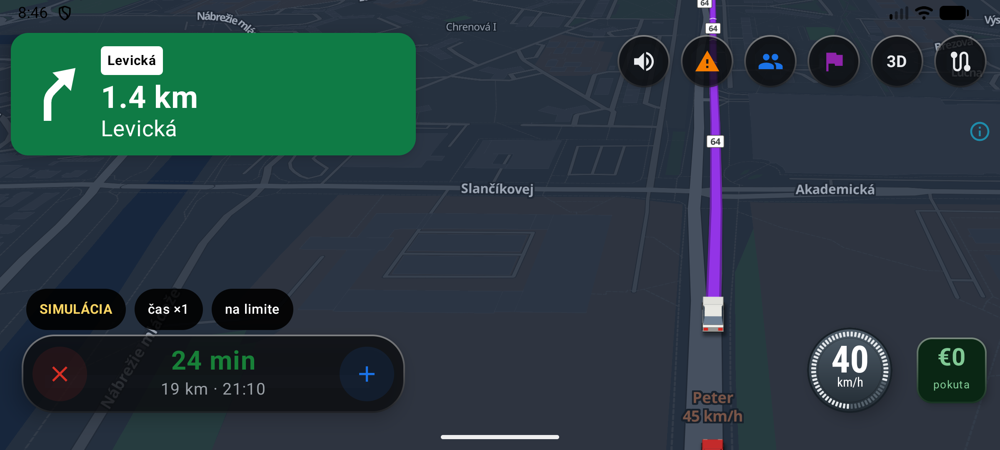
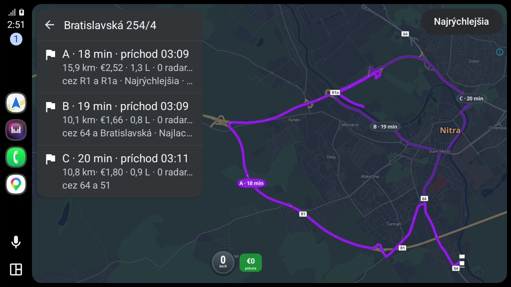
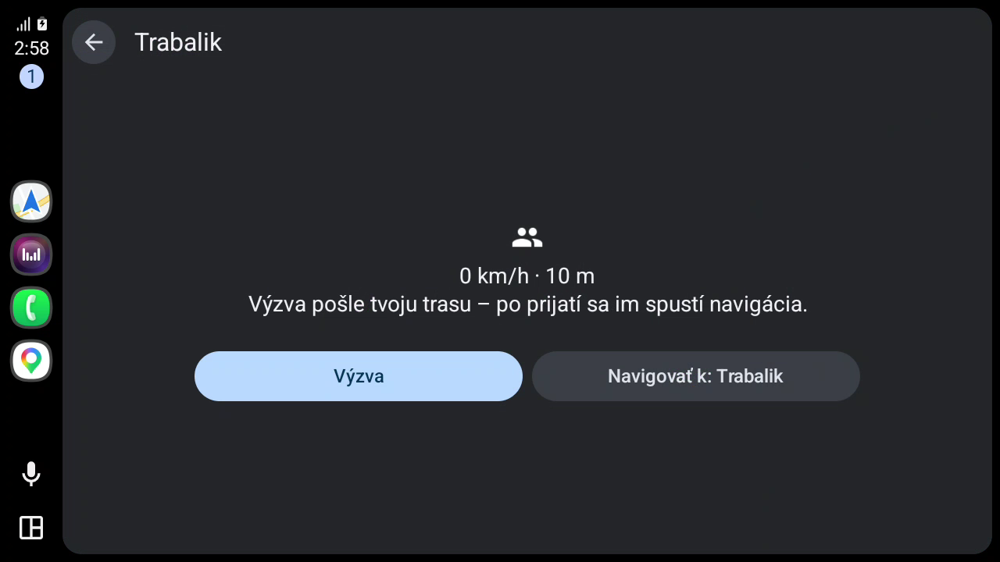
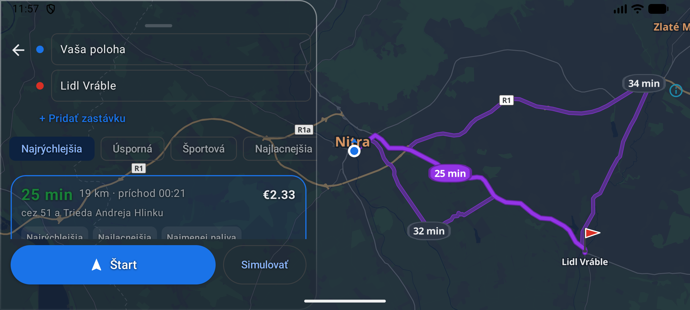
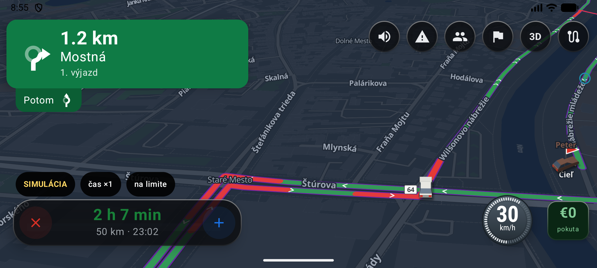
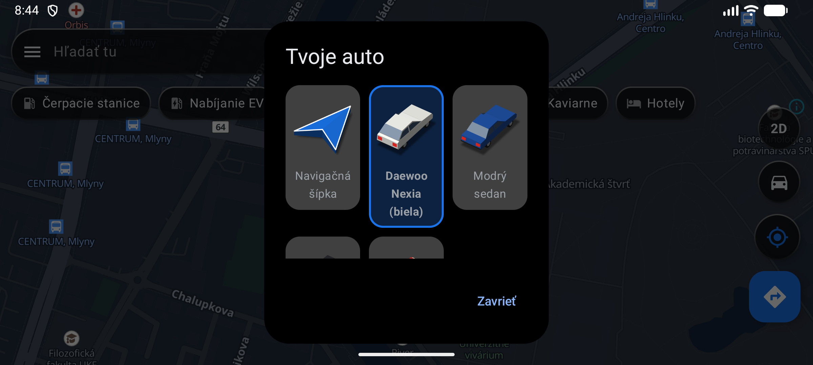

# DriveMap

A free navigation app for Android and Android Auto, built for driving in Slovakia and the rest of Europe. It does turn-by-turn navigation with speed camera alerts, live fuel prices, vignette-aware routing and a private convoy mode for driving together with friends.



## Download and install

### [⬇️ Download DriveMap for Android](https://github.com/martin6727/drivemap/releases/latest/download/DriveMap.apk)

Or scan this on your phone:


1. Tap the download link on your phone.
2. Open the downloaded **DriveMap.apk**. If Android asks, allow your browser to **install unknown apps**, then tap **Install**.
   Google Play Protect may say it doesn't know the app. Tap **More details → Install anyway**. That warning appears for any app that isn't from the Play Store.
3. Open DriveMap and allow location access. That's it.

**Updates:** when a new version is out, DriveMap tells you. Tap **Update**, then **Update** again on the next screen, and your settings and saved places stay.

Requires Android 8.0 or newer.

### Android Auto

Android Auto only shows navigation apps installed from the Play Store (its "Unknown sources" setting no longer covers them). DriveMap sets itself up for this once:

1. The first time you open DriveMap, it asks **Use DriveMap in your car?** Tap **Enable**.
2. If Android asks, allow DriveMap to **install unknown apps**, then go back.
3. Tap **Update**. If Play Protect asks, tap **More details → Install without scanning** (or let it scan; that works too).
4. Connect your phone to the car. DriveMap appears in the Android Auto app list. If you don't see it, check **Customize launcher** in Android Auto settings.

Missed the prompt? It's under **Settings → Android Auto → Show in Android Auto**. Updates from inside the app keep this setup. If you install a new version from the browser instead, do it again.

| Android Auto: pick a route | Tap a friend's car to challenge |
|---|---|
|  |  |

On the car screen you get the map, navigation with lanes, speed camera alerts, search ("Where to?", fuel, parking), hazard and police reports, and the convoy. Convoy members show their speed, you can send them a challenge, and incoming invites pop up with Accept and Decline.

## Features

- **Navigation**: Google-Maps-style turn-by-turn with lane guidance, roundabout exits, voice in Slovak, Czech, English, German, Hungarian and Polish, and three voice levels (full, normal, alerts only).
- **Route modes**: fastest, economical, sporty (twisty roads) and cheapest. Fuel cost uses each country's real pump prices, plus tolls and vignettes.
- **Vignettes**: add the ones you've bought. Routes avoid motorways where you don't have one, and you get a reminder before one expires.
- **Speed cameras**: fixed cameras, average-speed sections, red-light cameras, frequently-checked spots and live police or radar reports from other drivers. Sound and voice alerts, plus a fine estimate when you're over the limit.
- **Speedometer**: Waze-style. The ring fills toward the limit, and the limit sign pops up only when you're speeding.
- **Fuel prices**: daily official station prices in Spain, Austria and France, EU weekly averages everywhere else, and driver-reported prices in Slovakia.
- **Search**: addresses, places and businesses by name, nearest first. You can also long-press the map to add a stop or save a pin with your own name.
- **Convoy**: private groups with a shared code, end-to-end encrypted. You see your friends' cars live on the map with their speed and can share stops and the destination.
  - **Drive with me** sends your destination to the whole convoy.
  - **Challenge** sends a member your exact route. Whoever invites is the host, and everyone who accepts navigates the host's route. Accepting starts navigation straight away.
  - Challenge routes are coloured by their bends: green for straight, orange for medium and red for sharp bends and turns.
- **Your car**: tap your arrow to pick a 3D car. The choices are a navigation arrow, a white Daewoo Nexia, a sedan, an SUV or a sports car. Your convoy sees it too.
- **Looks**: OLED black night mode, 2D/3D view, landscape layout, and four themes: standard, liquid glass, light glass and clear glass.

| Route options | Challenge route | Pick your car |
|---|---|---|
|  |  |  |

## Good to know

- **Drive safely and follow the law.** Set your route before you drive and keep your eyes on the road. Challenges are about driving the same route together, not racing.
- **Speed camera warnings are illegal in some countries**, for example France, Germany and Switzerland. DriveMap hides them where it knows they're not allowed, but checking local rules is up to you.
- DriveMap uses free public services. If one is busy, a search or route can take a moment or fail. Try again.
- This is a hobby project, provided as is, without any warranty.

## Privacy

There's no account, no ads and no tracking. Your location stays on your phone, apart from these exceptions:

- **Convoy:** when you join a convoy, your position is shared with that group only. It's encrypted with a key derived from the group code, so the relay server can't read it.
- **Driver reports:** reports you send (police, radar, hazards and fuel prices) are shared anonymously with other DriveMap users near that spot.
- **Searches and route requests:** these go to the map services listed below.

## Credits

- Map data © [OpenStreetMap](https://www.openstreetmap.org/copyright) contributors (ODbL), which also covers speed cameras and places
- Map tiles: [OpenFreeMap](https://openfreemap.org) · rendering: [MapLibre](https://maplibre.org)
- Routing: [Valhalla](https://github.com/valhalla/valhalla) on the FOSSGIS servers
- Search: [Photon](https://photon.komoot.io) by komoot, [Nominatim](https://nominatim.org) and the [Overpass API](https://overpass-api.de)
- Fuel prices: EU Weekly Oil Bulletin, Spanish Ministry for the Ecological Transition, Austrian E-Control, and the French government open data on fuel prices
- Convoy relay: the public [HiveMQ](https://www.hivemq.com/mqtt/public-mqtt-broker/) MQTT broker

## Building from source

You need Android Studio (or its bundled JDK). Then run:

```
./gradlew assembleRelease
```

The APK lands in `app/build/outputs/apk/release/`.

---

## Slovensky: inštalácia

1. V telefóne ťukni na **[Stiahnuť DriveMap](https://github.com/martin6727/drivemap/releases/latest/download/DriveMap.apk)** (alebo naskenuj QR kód vyššie).
2. Otvor stiahnutý **DriveMap.apk**. Ak sa Android opýta, povoľ prehliadaču **inštalovať neznáme aplikácie** a ťukni na **Inštalovať**. Ak Play Protect upozorní, ťukni **Ďalšie podrobnosti → Napriek tomu inštalovať**.
3. Otvor DriveMap a povoľ prístup k polohe. Keď vyjde nová verzia, aplikácia ti ponúkne aktualizáciu.

**Android Auto:**

1. Pri prvom otvorení sa DriveMap opýta **Používať DriveMap v aute?** Ťukni na **Zapnúť**.
2. Ak sa Android opýta, povoľ DriveMapu **inštalovať neznáme aplikácie** a vráť sa späť.
3. Ťukni na **Aktualizovať**. Ak sa ozve Play Protect, ťukni **Ďalšie podrobnosti → Inštalovať bez kontroly** (alebo ju nechaj skontrolovať).
4. Pripoj telefón k autu. DriveMap sa objaví medzi aplikáciami (ak nie, pozri **Prispôsobiť spúšťač** v nastaveniach Android Auto).

Dá sa to zapnúť aj neskôr: **Nastavenia → Android Auto → Zobraziť v Android Auto**.
